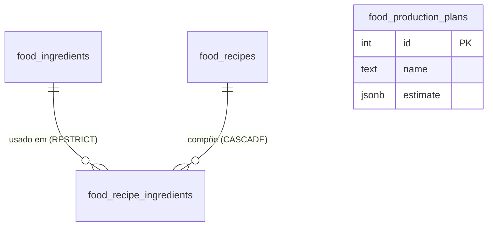

# Plan 003 — PRD: Base de dados PostgreSQL + publicação na Vercel

> **Status**: 🔄 Em andamento — código pronto e validado localmente; faltam provisionar o Neon e fazer o deploy (ações do usuário)
> D1 = Neon (confirmado) · D2 = dados locais são exemplos (seed/recomeço)
> **Agente responsável**: Orquestrador (coordena Backend → Frontend → QA)
> **Skills envolvidas**: `database-drizzle`, `backend-express`, `api-contract-first`, `dominio-custos`, `pnpm-workspace`, `qa-verificacao`

> Nota: o nome do arquivo é histórico (a primeira versão previa SQL Server). Decisão do usuário: **manter PostgreSQL + Drizzle**.

## 1. Contexto

O Miolo já usa PostgreSQL + Drizzle (`lib/db`), com banco local `miolo` (plan-002). Falta: (a) endurecer o schema, (b) um Postgres acessível pela internet, (c) adaptar a API Express para a Vercel.

## 2. Objetivos

- Manter o Postgres local para desenvolvimento.
- Provisionar Postgres em nuvem para produção.
- Ajustar o schema com a regra "insumo não repete na receita".
- Publicar frontend + API na Vercel.

**Fora de escopo**: autenticação, novas telas, mudança de fórmulas de custo.

## 3. Entidades

| Entidade | Tabela | Papel |
| --- | --- | --- |
| Insumos | `food_ingredients` | Matéria-prima comprada em pacote |
| Receitas | `food_recipes` | Produto produzido em lote |
| Itens da receita | `food_recipe_ingredients` | Composição receita ↔ insumo |
| Planos de produção | `food_production_plans` | Snapshot imutável (jsonb) |



### Mudanças de schema (único delta em relação ao atual)

Em [food-business.ts](file:///d:/clientes/obraprima/sistema/lib/db/src/schema/food-business.ts):

1. `food_recipe_ingredients`: **`UNIQUE (recipe_id, ingredient_id)`** (insumo não repete na receita) via `unique()` do Drizzle.
2. Índices em `recipe_id` e `ingredient_id`.
3. `CHECK` de positividade: `pack_quantity > 0`, `pack_price >= 0`, `yield_quantity > 0`, `quantity > 0`; `pack_unit IN ('kg','g','l','ml','un')`.

**Antes de aplicar**: verificar duplicatas existentes
```sql
SELECT recipe_id, ingredient_id, COUNT(*) FROM food_recipe_ingredients GROUP BY 1,2 HAVING COUNT(*) > 1;
```
Se houver, consolidar (somar quantidades) antes do `push`.

**Impacto na API**: criar/editar receita com insumo repetido deve retornar **400/409** com mensagem clara (validar no servidor antes do banco e traduzir erro `23505`). Se o contrato OpenAPI mudar (nova resposta de erro), seguir OpenAPI → codegen → backend → frontend. O frontend deve impedir selecionar o mesmo insumo duas vezes na receita.

## 4. Decisões

| # | Decisão | Recomendação |
| --- | --- | --- |
| D1 | **Postgres de produção** | **Neon** (via Vercel Marketplace) — serverless, plano gratuito, integra variáveis na Vercel. Alternativa: Supabase. |
| D2 | Dados atuais do `miolo` local | Exemplos → recomeçar com seed; se houver dados reais, `pg_dump` local → restore no Neon. |
| D3 | Estratégia Vercel | Um projeto: frontend Vite estático + API Express como Serverless Function (`api/index.ts`). |
| D4 | Driver em produção | `pg` com pool pequeno (`max: 1–3`) usando a URL **pooled** do Neon; ou `@neondatabase/serverless` com `drizzle-orm/neon-http` se houver problemas de conexão. |

## 5. Divisão por agentes

Ordem: **Orquestrador → Backend → Frontend → QA**.

### Orquestrador
- Fechar D1–D4; abrir execução; ao final atualizar `docs/README.md`, `docs/arquitetura.md`, `docs/dominio-custos-alimentos.md` (restrição de unicidade), `skills/database-drizzle.md` e `replit.md`.

### Backend
1. Alterar schema (seção 3) e rodar `pnpm --filter @workspace/db run push` no local.
2. Validação/tradução do erro de duplicidade nas rotas de receita.
3. Adaptar `lib/db/src/index.ts`: pool com `max` baixo e SSL (`ssl: { rejectUnauthorized: false }` ou `?sslmode=require` na URL) quando `NODE_ENV=production`.
4. Separar `app` do `listen`: exportar o app Express e criar `api/index.ts` (handler serverless). Manter `listen` só no dev/Replit.
5. `vercel.json`: rewrites `/api/(.*)` → função; fallback SPA para `index.html`; `buildCommand` pnpm; `outputDirectory` do `custos-alimentos` (`dist/public` ou equivalente).
6. Em produção, aplicar schema no Neon via `DATABASE_URL` de prod (`drizzle-kit push` manual ou migrations versionadas — preferir **migrations** `drizzle-kit generate/migrate` para produção).
7. Seed opcional (marcado como exemplo).

### Frontend
- Impedir insumo duplicado no formulário de receita e exibir erro da API.
- `BASE_PATH=/` e `/api` relativo na Vercel (sem proxy do Vite).

### QA (`skills/qa-verificacao.md`)
- [x] `pnpm run typecheck` limpo em todos os 9 projetos do monorepo.
- [x] Inserir insumo repetido na mesma receita → bloqueado (UI e API com 400).
- [x] Constraint `UNIQUE (recipe_id, ingredient_id)` ativa e testada no PostgreSQL.
- [x] Mesmo insumo em receitas diferentes → permitido.
- [x] Excluir insumo em uso bloqueado (409 / RESTRICT); excluir receita remove itens (CASCADE); plano salvo inalterado após mudar preço (snapshot imutável).
- [x] `/api/healthz` 200 local (e no handler serverless compilado).
- [x] Script de seed idempotente criado (`pnpm --filter @workspace/db run seed`) com 8 insumos e receitas de exemplo.
- [x] Migration SQL gerada e versionada em `lib/db/drizzle/0000_stormy_tyrannus.sql`.
- [x] Build de deploy Vercel configurado e testado (`pnpm run build:vercel`).
- [ ] Deploy de preview na Vercel conectando ao Neon (aguarda criação do banco pelo usuário).

## 6. Variáveis de ambiente (Vercel)

| Variável | Onde |
| --- | --- |
| `DATABASE_URL` | Vercel (Production/Preview) — URL pooled do Neon com `sslmode=require` |
| `NODE_ENV=production` | Vercel (automático) |

Nunca versionar `.env`. Usar bancos/branches separados para Preview e Production.

## 7. Riscos

| Risco | Mitigação |
| --- | --- |
| Esgotar conexões em serverless | Pool pequeno + URL pooled |
| Duplicatas existentes quebram `UNIQUE` | Query de verificação antes do push |
| Express fora do padrão serverless | Exportar app sem `listen` |
| Schema de prod divergir do local | Migrations versionadas |

## 8. Critérios de aceite

1. Constraint `UNIQUE (recipe_id, ingredient_id)` ativa local e em produção.
2. Aplicação publicada na Vercel usando Postgres em nuvem.
3. Typecheck limpo e checklist de QA completo.
4. Documentação atualizada.

## 9. Próximos passos

1. Confirmar D1 (Neon?) e D2 (dados locais são exemplo?).
2. Backend executa seção 5; depois Frontend e QA.
