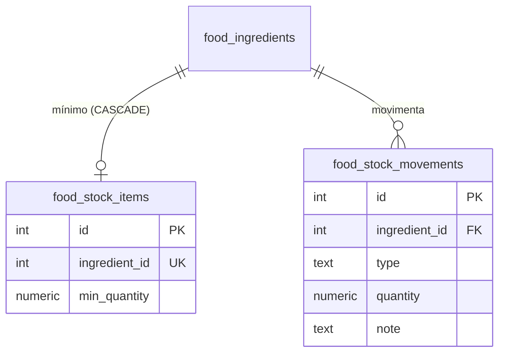

# Plan 004 — PRD: Controle de Estoque de Insumos (com estoque mínimo)

> **Status**: 📝 Rascunho — D1, D2, D3, D5 confirmadas; D4 pendente (recomendação: bloquear com 409)
> **Agente responsável**: Orquestrador (coordena Backend → Frontend → QA)
> **Skills envolvidas**: `database-drizzle`, `backend-express`, `api-contract-first`, `frontend-react`, `dominio-custos`, `pnpm-workspace`, `qa-verificacao`

## 1. Contexto

O Miolo cadastra insumos (`food_ingredients`) e receitas, mas **não sabe quanto há de cada insumo em casa**. O plano de produção gera a lista consolidada de compras considerando a necessidade bruta, sem abater o que já existe, e o produtor não é avisado quando um insumo está acabando.

## 2. Objetivos

1. Registrar a **quantidade em estoque** de cada insumo, com histórico de movimentações.
2. Definir **estoque mínimo** por insumo e sinalizar os itens abaixo dele.
3. Carregar **todos os insumos já cadastrados** no controle de estoque via **script** (estoque 0 e mínimo configurável).
4. **Fase 2 (confirmada, D5)**: o plano de produção considera o estoque e a lista de compras sugere só a diferença (`necessário − saldo`). Executada após a v1, ainda neste plano (seção 7.5).

**Fora de escopo (v1)**: lote/validade, múltiplos locais, custo médio ponderado, baixa automática por produção realizada, autenticação.

## 3. Modelo de dados

### Regras de domínio

- Estoque e estoque mínimo são expressos na **unidade base** do insumo (`kg`→`g`, `l`→`ml`, `g`/`ml`/`un` direto), a mesma usada em `food_recipe_ingredients.quantity`. Isso evita conversões na comparação com receitas.
- O **saldo é derivado**: `saldo = Σ movimentações`. Não é editado diretamente; ajuste = movimento do tipo `ajuste`.
- Custos de receita **continuam derivados do preço do insumo** (estoque não altera custo — regra do `dominio-custos`).
- Status: `sem_estoque` (saldo ≤ 0), `abaixo_minimo` (0 < saldo < mínimo), `ok` (saldo ≥ mínimo). Mínimo 0 = alerta desligado.

### Tabelas novas (em `lib/db/src/schema/`, arquivo novo `food-stock.ts`)

| Tabela | Campos | Observações |
| --- | --- | --- |
| `food_stock_items` | `id`, `ingredient_id` (UNIQUE, FK → `food_ingredients` **CASCADE**), `min_quantity` numeric(12,4) default 0, `created_at`, `updated_at` | 1:1 com insumo. `CHECK (min_quantity >= 0)`. |
| `food_stock_movements` | `id`, `ingredient_id` (FK RESTRICT... ver D4), `type` (`entrada`/`saida`/`ajuste`/`inicial`), `quantity` numeric(12,4) (assinada na unidade base), `note` text null, `created_at` | Índice em `(ingredient_id, created_at)`. `CHECK type IN (...)`; `quantity <> 0`. Imutável (sem update/delete). |

> Saldo calculado na consulta (`SUM(quantity) GROUP BY ingredient_id`). Se performance virar problema, avaliar coluna materializada — não é necessário na v1.

### Impacto em tabelas existentes
Nenhum. Exclusão de insumo: já é bloqueada se em uso por receita; movimentações seguem a decisão D4.

## 4. Decisões a confirmar

| # | Decisão | Recomendação |
| --- | --- | --- |
| D1 | Unidade do estoque | ✅ **Unidade base** do insumo (g/ml/un); UI mostra também na unidade do pacote (ex.: 2,5 kg). |
| D2 | Modelo de saldo | ✅ **Os dois**: histórico de movimentações (ledger) **e** edição direta do saldo na tela. A edição direta é o movimento `ajuste` (usuário informa o saldo final; o servidor grava a diferença), então o histórico nunca se perde. |
| D3 | Carga inicial (script) | ✅ Cria `food_stock_items` para **todos** os insumos com **mínimo 0** e **saldo 0** (sem movimento). `--min-default` e `--saldo` continuam opcionais. |
| D4 | Excluir insumo com histórico de estoque | ⏳ **Pendente.** Recomendação: **bloquear (409)** se houver movimentações com saldo ≠ 0; se saldo = 0 e só houver o registro de estoque, permitir e apagar o estoque junto. |
| D5 | Fase 2 (plano de produção usa estoque) | ✅ **Sim**, incluída neste plano (seção 7.5), após a v1. |

## 5. Script de carga inicial

Arquivo: `lib/db/src/seed-stock.ts` (padrão de [seed.ts](file:///d:/clientes/obraprima/sistema/lib/db/src/seed.ts): carrega `.env` da raiz, usa `db` de `./index`).

Script em `lib/db/package.json`: `"seed-stock": "tsx ./src/seed-stock.ts"`; atalho na raiz: `"db:seed-stock"`.

Comportamento:
1. Lê todos os `food_ingredients`.
2. Para cada insumo **sem** linha em `food_stock_items`, insere `{ ingredientId, minQuantity }` (`INSERT ... ON CONFLICT (ingredient_id) DO NOTHING` → **idempotente**, nunca sobrescreve mínimos já ajustados).
3. Opções: `--min-default=<n>` (mínimo na unidade base, padrão 0), `--saldo=<n>` (cria movimento `inicial` com esse saldo para itens novos), `--dry-run` (apenas lista).
4. Imprime resumo: criados / já existentes / total.
5. Também deve ser chamado por `import-receitas.ts` ao final? **Não** na v1 (mudanças mínimas); rodar manualmente. Atualizar `clear.ts` para limpar as novas tabelas **antes** de `food_ingredients`.

> Regra de segurança: o script não apaga nem altera dados existentes.

## 6. Contrato da API (OpenAPI → codegen → backend → frontend)

Em `lib/api-spec/openapi.yaml`:

| Método | Rota | Descrição |
| --- | --- | --- |
| GET | `/stock` | Lista insumos com `onHand`, `minQuantity`, `baseUnit`, `status`; filtros `status`, `search`. |
| PATCH | `/stock/{ingredientId}` | Atualiza `minQuantity` (≥ 0). |
| POST | `/stock/{ingredientId}/movements` | Cria movimento `{ type: entrada\|saida\|ajuste, quantity, note? }`. `saida` não pode deixar saldo < 0 (400). `ajuste` aceita valor final e o servidor grava a diferença. |
| GET | `/stock/{ingredientId}/movements` | Histórico paginado. |
| GET | `/stock/alerts` | Itens `abaixo_minimo`/`sem_estoque` + contadores (para o badge da navegação). |

Erros: 400 (validação), 404 (insumo/estoque inexistente), 409 (conflitos). Schemas Zod vêm do Orval — **nunca** editar `lib/api-zod/` nem `lib/api-client-react/`.

## 7. Divisão por agentes (multi-agent)

Ordem obrigatória: **Orquestrador → Backend → Frontend → QA**. Cada agente só avança quando o anterior entrega seus critérios.

### 7.1 Orquestrador
- Fechar D1–D5 com o usuário; reservar este plano como `plan-004`.
- Ao final, atualizar: `docs/dominio-custos-alimentos.md` (entidades e regras de estoque), `docs/README.md` (comando `db:seed-stock`), `docs/arquitetura.md`, `skills/database-drizzle.md`, `skills/dominio-custos.md`, `replit.md`.

### 7.2 Backend (`agents/backend.md`)
1. Criar schema `food-stock.ts`, exportar em `lib/db/src/schema/index.ts` e `pnpm --filter @workspace/db run push`.
2. Gerar migration versionada (`generate`), como no plan-003.
3. Criar `seed-stock.ts` + scripts no `package.json`; ajustar `clear.ts`.
4. Atualizar `openapi.yaml` → `pnpm --filter @workspace/api-spec run codegen`.
5. Rotas Express `routes/stock.ts` usando os schemas Zod gerados; cálculo de saldo/status em função pura; transação ao gravar movimento (checar saldo dentro da transação).
6. Garantir 409 ao excluir insumo com histórico (D4) nas rotas de insumos.

### 7.3 Frontend (`agents/frontend.md`)
1. Nova página **Estoque** (rota `/estoque`, item no menu) com tabela: insumo, saldo, mínimo, status (badge verde/amarelo/vermelho), ações.
2. Filtros: busca, status (todos / abaixo do mínimo / sem estoque).
3. Diálogos: **Movimentar** (entrada/saída/ajuste + observação), **Editar mínimo**, **Histórico**.
4. Badge de alertas no menu via `/stock/alerts`.
5. Somente hooks gerados (`@workspace/api-client-react`); invalidar queries de `/stock` após mutações; toasts em pt-BR; estado vazio orientando a rodar `pnpm run db:seed-stock`.
6. Exibir unidade base + equivalente na unidade do pacote.

### 7.4 QA (`agents/qa.md` + `skills/qa-verificacao.md`)
- [ ] `pnpm run typecheck` limpo em todos os projetos.
- [ ] `pnpm run db:seed-stock` cria um registro por insumo; 2ª execução não duplica nem sobrescreve mínimo (idempotente); `--dry-run` não grava.
- [ ] Entrada/saída/ajuste atualizam saldo corretamente, inclusive conversão kg→g e l→ml.
- [ ] Saída acima do saldo → 400; saldo nunca negativo.
- [ ] Item muda de `ok` → `abaixo_minimo` → `sem_estoque` conforme movimentos e mínimo.
- [ ] Mínimo 0 não gera alerta; mínimo negativo → 400.
- [ ] Custos de receitas e planos salvos **inalterados** por movimentações (snapshot e derivação preservados).
- [ ] Excluir insumo com histórico → 409 com mensagem clara na UI.
- [ ] Excluir/limpar banco (`db:clear`) funciona com as novas tabelas.
- [ ] Smoke test no navegador: fluxo completo de movimentação e filtro de alertas.

### 7.5 Fase 2 — Plano de produção com estoque (todos os agentes, após a v1)
- **Backend**: `POST /production/estimate` passa a retornar, por insumo consolidado, `onHand` e `toBuy = max(0, necessário − saldo)`, mais custo estimado da compra. Contrato via OpenAPI → codegen. Fórmulas de custo **inalteradas** (custo continua sobre o necessário, não sobre a compra).
- **Frontend**: lista de compras mostra necessário / em estoque / comprar; destaca insumos que ficariam abaixo do mínimo após a produção.
- **Snapshot**: planos salvos gravam o `onHand` do momento no JSON (continuam imutáveis).
- **Sem baixa automática**: salvar o plano não movimenta estoque (baixa por produção realizada fica para plano futuro).
- **QA**: lista de compras = necessário − saldo; saldo maior que necessário → comprar 0; plano salvo não muda após novas movimentações.

## 8. Riscos

| Risco | Mitigação |
| --- | --- |
| Divergência de unidade (pacote × base) | Tudo persistido em unidade base; conversão só na UI/borda da API. |
| Condição de corrida em saídas simultâneas | Transação + checagem de saldo na mesma transação. |
| Insumos novos sem registro de estoque | `GET /stock` faz LEFT JOIN (saldo 0, mínimo 0) e/ou criação automática ao cadastrar insumo (decidir no Backend). |
| Schema de prod divergir do local | Migration versionada (padrão plan-003). |
| Escopo crescer (lotes, validade) | Mantido fora da v1; registrar em plano futuro. |

## 9. Critérios de aceite

1. Todos os insumos existentes aparecem na tela de Estoque após rodar o script de carga.
2. É possível definir estoque mínimo e movimentar entradas/saídas/ajustes com histórico.
3. Itens abaixo do mínimo ficam destacados e contados no menu.
4. Custos e planos de produção permanecem inalterados.
5. Typecheck limpo, checklist de QA completo e documentação atualizada.

## 10. Próximos passos

1. Usuário confirma D1–D5.
2. Backend executa 7.2 → Frontend 7.3 → QA 7.4.
3. Plano futuro (fase 2): abater estoque no plano de produção e sugerir compras pela diferença.
